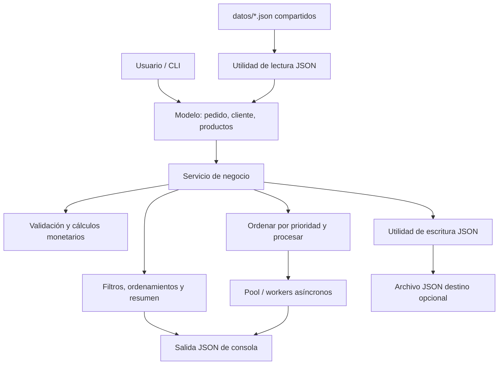

# Diagrama de arquitectura

Cada lenguaje implementa el mismo flujo con sus primitivas: `ThreadPoolExecutor` en Python, trabajadores `async` coordinados por promesas en Node.js y `ExecutorService` en Java.
